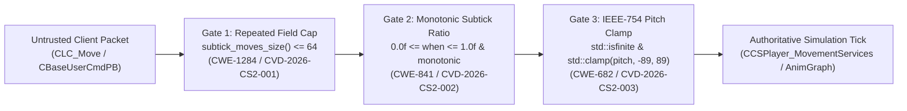

# Audit Preparation & Architecture Package (`AUDIT_PREP.md`)

- **Project:** `cs-telemetry-internals` (`v1.0.1`)
- **Archival DOI:** [`10.5281/zenodo.23640494`](https://doi.org/10.5281/zenodo.23640494)
- **Lead Researcher:** Serhii Shunko (`@sshunko` / `@ccsimplyspolit`, ORCID [`0009-0002-4183-0361`](https://orcid.org/0009-0002-4183-0361))
- **Methodology:** Trail of Bits Audit Preparation Checklist (`audit-prep-assistant`)

---

## 1. Review Goals & Scope

### Security Objectives
1. **Server-Side Protobuf Input Validation (`CVD-2026-CS2-001..003`):** Document and verify defensive server-side bounds for `CBaseUserCmdPB.subtick_moves`, fractional subtick delta-time (`when`), and IEEE-754 view-angle pitch (`m_angEyeAngles` at `+0x1340`).
2. **Backend API & Deserialization Hardening (`ADV-2026-003..005`):** Provide formal specifications and defensive patches for replay-fetcher SSRF (`CWE-918`), KeyValues/VDF recursive parser exhaustion (`CWE-674`/`CWE-943`), and OpenID 2.0 assertion replay (`CWE-290`/`CWE-294`).
3. **Standalone & IDAPython Tooling Verification:** Ensure `tools/vac_module_analyzer.py` executes cleanly both inside IDA Pro and in standalone CLI/CI environments.

### In-Scope Repository Layout
| Path | Description |
|---|---|
| `advisories/valve_server_disclosures/H1_Report_*.md` | Coordinated vulnerability disclosure reports (`CVD-2026-CS2-001..003`) with C++ remediation diffs |
| `advisories/api_security_audits/ADV-2026-003..005_*.md` | Backend SSRF, VDF/KeyValues, and OpenID 2.0 security advisories |
| `advisories/ADV-2026-001_memory_scanning_telemetry.md` | Endpoint virtual memory inspection specification (`ADV-2026-001`) |
| `docs/*.md` | 6 deep technical whitepapers on `server.dll` static auditing, subtick telemetry, and relocation-aware hashing |
| `tools/vac_module_analyzer.py` | Dual-mode (IDAPython + standalone CLI) memory-integrity primitive scanner |
| `test_vac_module_analyzer.py` | Automated unit test suite (`3/3 PASS`) |

---

## 2. Verification & Test Suite Execution

```bash
git clone https://github.com/ccsimplyspolit/cs-telemetry-internals.git
cd cs-telemetry-internals
python -m unittest discover -v
```

---

## 3. Server-Side Input Validation Data-Flow Diagram


