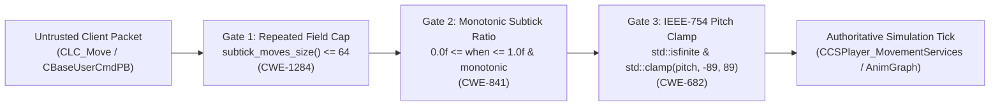

# Audit Preparation & Architecture Package (`AUDIT_PREP.md`)

- **Project:** `cs-telemetry-internals` (`v1.0.1`)
- **Lead Researcher:** Serhii Shunko (`@sshunko` / `@ccsimplyspolit`, ORCID [`0009-0002-4183-0361`](https://orcid.org/0009-0002-4183-0361))
- **Methodology:** Trail of Bits Audit Preparation Checklist (Static & Dynamic Verification Suite)

---

## 1. Review Goals & Scope

### Security Objectives
1. **Server-Side Protobuf Input Validation Architecture:** Document and verify defensive server-side bounds for `CBaseUserCmdPB.subtick_moves`, fractional subtick delta-time (`when`), and IEEE-754 view-angle pitch (`m_angEyeAngles` at `+0x1340`).
2. **Endpoint Memory Traversal & Relocation-Aware Hashing:** Document virtual address space inspection (`NtQueryVirtualMemory` / `MEMORY_BASIC_INFORMATION`), PE mapping vector telemetry, and VMProtect handler analysis across 6 technical whitepapers.
3. **Standalone & IDAPython Tooling Verification:** Ensure `tools/vac_module_analyzer.py` executes cleanly both inside IDA Pro and in standalone CLI/CI environments (`3/3 PASS`).

### In-Scope Repository Layout
| Path | Description |
|---|---|
| `docs/server_dll_input_audit.md` | Static Hex-Rays audit of server input processing (`server.dll` v14171) |
| `docs/subtick_protobuf_telemetry.md` | Subtick input validation & protobuf wire-format telemetry in Source 2 |
| `docs/vac_subtick_false_positive_mitigation.md` | Mathematical false-positive mitigation model for subtick telemetry |
| `docs/telemetry_protocol_analysis.md` | Client telemetry protocol & `MEMORY_BASIC_INFORMATION` traversal specification |
| `docs/pe_injection_vectors_telemetry.md` | Windows PE in-memory mapping vectors & kernel telemetry observability |
| `docs/vmp_devirtualization_atlas.md` | VMProtect 3.6–3.10.5 devirtualization atlas & handler dispatch analysis |
| `tools/vac_module_analyzer.py` | Dual-mode (IDAPython + standalone CLI) memory-integrity primitive scanner |
| `test_vac_module_analyzer.py` | Automated unit test suite (`3/3 PASS`) |

---

## 2. Verification & Test Suite Execution

```bash
git clone https://github.com/ccsimplyspolit/cs-telemetry-internals.git
cd cs-telemetry-internals
python -m unittest discover -v
```

---

## 3. Server-Side Input Validation Data-Flow Diagram


